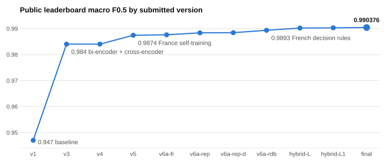
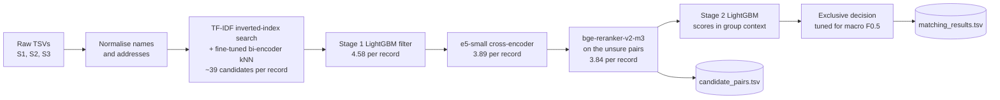

# Business Entity Resolution at 10-million-record scale

Our team's solution to the **Amazon ML Challenge 2026** (Business Entity Resolution): find
every noisy Source 2/3 record that describes the same business as a Source 1 record, across
three sources with no shared identifier and a country (France) the training data never shows.
Team PerryDaPlatypus finished in the **top 50**, with a public-leaderboard macro F0.5 of
**0.990376**.

<picture>
  <source media="(prefers-color-scheme: dark)" srcset="docs/img/leaderboard-dark.svg">
  
</picture>

| | |
|---|---|
| Public leaderboard, macro F0.5 | **0.990376** (final submission) |
| Held-out training entities, US/India | 0.9912 macro F0.5 |
| Data | train 2.2M Source 1 × 10.3M Source 2/3 records; test 1.7M × 10.0M |
| Candidates kept per Source 1 record | 3.84 on test, from about 39 after search; the cascade keeps 99.25% of true pairs on held-out entities |
| Hardware | one laptop: 24-thread CPU, 31 GB RAM, RTX 5080 16 GB |

## The problem

Source 1 is a deduplicated list of businesses. Sources 2 and 3 hold copies of them with
dropped or moved legal forms, typos, transliterations, trade-name aliases, reordered or
missing address parts, and about 26% decoys: the same name at a neighbouring house number,
one word changed at the same address, rebrands, branch words added. For each Source 1 record
the pipeline outputs the Source 2/3 records that match it. Scoring is F0.5 per Source 1
record, averaged over all of them (records with no match included), so a wrong merge costs
about twice as much as a missed one.

Three things made it hard:

- **Scale.** About 10 million candidate records per split, on one machine.
- **An unseen country.** About 15% of test is French. Train has only US and Indian
  businesses, so French names, accents, address formats and decoy vocabulary had no labels.
- **A shifted test set.** Test carries about twice train's decoys per business. Rules tuned
  on train over-merge on test.

The [condensed brief](docs/problem_statement.md) lists the file formats, the metric and the
rules, with the place in the code that enforces each.

## How it works



1. **Candidate generation as a cascade.** Per-country inverted-index TF-IDF search over name
   and address views, plus the nearest neighbours of a multilingual-e5-small bi-encoder
   fine-tuned on 40% of the training businesses, propose about 39 candidates per Source 1
   record (99.59% of true pairs). Three learned stages then prune them: a LightGBM filter
   over cheap pair features, a fine-tuned e5-small cross-encoder, and bge-reranker-v2-m3 on
   the pairs the small one is unsure of. That leaves 3.84 candidates per record on test; on
   held-out training entities the cascade keeps 99.25% of true pairs.
2. **Scores in group context.** Every model score is also given as its rank, gap and margin
   among the business's candidates and among the record's other suitors. A Source 2/3 record
   belongs to at most one business, and these columns are what decide which one.
3. **Stacking and an exclusive decision.** A second LightGBM reads the cross-encoder scores
   in that context. Each record goes to its best suitor only, and a two-threshold rule
   (the business's best candidate against the rest) is tuned on the exact leaderboard metric.
4. **France as unsupervised domain adaptation.** French test pairs that two independent
   versions of the pipeline both decided confidently become pseudo labels. The cross-encoders
   retrain on them mixed with labelled US/India pairs, and a gate keeps an adapted model only
   if its held-out US/India log-loss stays within tolerance. A simulator of the generator's
   copy operators, replayed on French Source 1 records, gives labelled French examples too.
   Four rounds of this ran. v5, the first version with it, moved the public score from 0.984
   to 0.987405, about 70% of that gain from France.
5. **Each country from the run that decides it best.** US and India come from the last run
   (v11), France from the run whose French decisions the leaderboard confirmed (v6a), and two
   vetoes remove US/India matches shaped like the generator's planted lookalikes.

The [methodology](docs/methodology.md) has the details and the measurements behind each step:
features, training data for each model, the gate's results, candidate counts per stage, the
score of every version and the common errors. Machine-readable aggregate metrics, gate outcomes,
and held-out breakdowns are checked into [`results/summary.json`](results/summary.json).

## Decisions that mattered

**Learned pruning instead of a fixed top-k.** A top-5 cut per business gives 3.63
candidates but costs 0.0056 F0.5, because some businesses have up to 11 true copies. A score
threshold from each learned stage gives 3.84 candidates at no measurable loss: the
cross-encoder cut left the matching output byte-identical. The cost is three models in front
of the matcher, and the stage-1 filter drops 0.34% of true pairs that the matcher would
almost never have accepted.

**Treat France as an adaptation problem, not a translation problem.** No French labels exist.
Self-training carried most of the gain from 0.984 to 0.987405, and its risk is the model
confirming its own errors. Three guards kept that in check: labels only where two independently trained runs
agree, at least half of every training mix from labelled US/India pairs, and a held-out gate
on US/India before any adapted model is used.

**Tune for test's decoy density.** Test has about twice train's planted lookalikes per
business. Re-tuning the decision rule with each training lookalike counted twice raised the
thresholds for non-top candidates from 0.74 to 0.82, gained +0.00012 on a re-weighted holdout
and +0.000066 on the leaderboard. The two lookalike vetoes follow the same reasoning.

**French decision rules from measured patterns.** Four rules adjust French probabilities: a
log-odds shift set by leaderboard probes, and three rules for copy and decoy shapes whose
truth rate was measured on train. The largest rejects same-address
records that swap one name word for another common French word ("Forme Ecole SA" to "Forme
Amicale SA"): on train this shape is 10% (US) and 1% (India) true, yet the self-trained
scorers accepted a third of them. Removing them gained +0.0009 on the leaderboard.

### What did not help

| Idea | Result |
|---|---|
| Averaging two runs' probabilities | +0.00004 on the holdout, not used |
| Per-country or per-group decision rules | −0.00002 on the holdout |
| Forcing each address-less record onto its likeliest suitor | −0.00047 on the holdout |
| A listwise reranker as a stage-2 feature | accepted 27.8k planted US lookalikes; public 0.985907 while the best run without it stood at 0.987583 |
| A model over each business's whole candidate set | public 0.989257, against 0.990376 |

## Repository layout

```
src/ber/
  schema.py, io.py         data contract; strict TSV reading, LF/no-quote writing
  normalize/, table.py     names (legal forms, aliases, consonant keys), addresses, cached tables
  vectorize.py, blocking/  hashed TF-IDF views and per-country inverted-index search
  embed.py                 bi-encoder fine-tuning, encoding, per-country GPU kNN
  crossenc.py              cross-encoder training and scoring (PyTorch)
  listwise.py              listwise rerankers C1/C7 (PyTorch; contributed by V Nikhil)
  scale.py                 the pipeline: blocking cascade, features, stages 1-2, prediction
  pairfeat.py              pair, detail, collective and name-cluster features
  tuning.py, decision.py   macro-F0.5 decision rules; 2x decoy-density emulation (V Nikhil)
  rescue.py, vocab.py      France's decision rules; country-specific pool vocab (V Nikhil)
  modeltext.py             accent-folded model text helper (V Nikhil)
  metrics.py, matcher.py   the leaderboard metric; entity folds
  submission.py            output writer and format validator
  pretrained.py, cli.py    licence and size registry of the encoders; command line
scripts/
  reproduce.sh             raw data to both submitted files, every step in order
  setup_envs.sh            the two Python environments reproduce.sh needs
  rule_variant.py          a run's decision from its saved scores (cascade, density rule, French rules)
  combine_by_country.py    the per-country combination and the two lookalike vetoes
  make_pseudo_labels*.py, mix_pseudo_labels.py   French pseudo labels, rounds 1-4
  synth_france.py, copy_profiles.py              the French copy simulator
  ce_gate.py, make_ce_eval_pairs.py, make_france_sample.py   the held-out gate
  make_lw_groups.py        training groups for the listwise rerankers
  score_submission.py      an independent, standard-library scorer for any output file
docs/                      methodology, condensed problem statement, chart
tests/                     unit and end-to-end tests on synthetic data, fair-play guards
```

## Running it

### Tests and a synthetic demo (CPU, a few minutes)

The challenge data is not included. `tests/synth.py` writes a synthetic dataset in the same
format, with the noise and traps the brief describes and France only in test, so the whole
pipeline can run without it. Python 3.10:

```bash
python -m venv .venv && source .venv/bin/activate   # Windows: .venv\Scripts\activate
pip install -r requirements-dev.txt
pip install -e . --no-deps
pytest -q                                           # 190 tests in under a minute; 2 need PyTorch
```

Then run the pipeline end to end on synthetic data and score it with the independent scorer:

```bash
python -c "from tests.synth import SynthConfig, write_synthetic; write_synthetic('demo-data', SynthConfig(train_entities=3000, test_entities=2000, seed=7))"
python -m ber.cli run --data-dir demo-data --out-dir output-demo --set scale.train_sample=1500
python scripts/score_submission.py --pred output-demo/matching_results.tsv --truth demo-data/test/test_ground_truth.tsv
```

The run prints blocking recall, stage-1 and stage-2 holdout scores and the test score against
the synthetic truth, and writes its models, metrics and resolved config under `runs/`. Scores
on synthetic data show that the pipeline works, not how it ranks.

### Reproducing the submitted files

With the challenge data in `<DATA_DIR>` (holding `train/` and `test/`):

```bash
bash scripts/setup_envs.sh
CPU=.venv/bin/python GPU=.venv-gpu/bin/python bash scripts/reproduce.sh <DATA_DIR>
```

- **Environments.** `requirements.txt` (Python 3.10) runs the pipeline. `requirements-gpu.txt`
  (Python 3.13, PyTorch, transformers) trains and scores the encoders. All versions are pinned.
- **Time.** About 57 hours on the laptop above. Every step skips work whose product already
  exists, so an interrupted run can be restarted.
- **What it builds.** The pretrained encoders are downloaded once; every other model is
  trained from the challenge's train data. The script replays every run the final file
  depends on (v3 to v11), because each one taught the next round of French pseudo labels.
  Each step is commented with what it does and how long it took.
- **Output.** `output/matching_results.tsv` and `output/candidate_pairs.tsv`.

The code here is the code of the submitted package with unused parts removed. On the
synthetic dataset above, a run, its decision (`rule_variant.py`) and the per-country
combination (`combine_by_country.py`) produce byte-identical files from both versions.

### Configuration

Every tunable is in [`src/ber/configs/default.yaml`](src/ber/configs/default.yaml), which
mirrors the typed dataclasses in [`src/ber/config.py`](src/ber/config.py); unknown keys are
errors. Override values with a file or dotted keys:

```bash
python -m ber.cli run --config src/ber/configs/full.yaml --data-dir <DATA_DIR> --set scale.k_emb=20
```

Each run directory stores the resolved config, `metrics.json` (overall, per-country,
per-cardinality and blocking metrics, plus the git revision), the decision rules' holdout
scores, feature importance and error tables.

## Rules the code enforces

- **No external data.** `tests/test_fair_play.py` lets the pipeline import only the standard
  library (without its networking modules) and the pinned dependencies. The exceptions are
  PyTorch and transformers for the local encoders and the one-time weight download in
  `pretrained.py`.
- **Model licence and size.** The matchers are LightGBM (MIT) and three pretrained encoders
  registered in `ber.pretrained.REGISTRY`: multilingual-e5-small and -base (MIT) and
  bge-reranker-v2-m3 (Apache-2.0), all well under the 8B-parameter limit.
- **Country is an open set.** No feature encodes a country and nothing filters to US and
  India; a test guards this, and France is covered end to end on synthetic data.
- **Output format.** One row per Source 1 record, LF endings, no quoting, and matches are a
  subset of candidates by construction. `ber.submission` validates every file it writes.

## Limitations

- **Reproduction is long.** 57 hours on one machine, because the French labels of each round
  come from the runs before it. Training the final models straight from the last round's
  labels would be much shorter, but it was not measured, so the script replays the chain
  that produced the submitted file.
- **Some choices used the public leaderboard.** France's log-odds shift, which French rules
  to keep, the two vetoes and which run decides each country were all checked against the
  public leaderboard (disclosed in the methodology). The private leaderboard may reward them
  less than the public one did.
- **Tuned to this generator.** The decoy-density re-tuning, the lookalike vetoes and the French
  rules target the patterns of the challenge's synthetic data. They are not evidence about
  real business records.
- **France has no held-out score.** The 0.9912 held-out figure covers US and India only; the
  French share is known only through leaderboard probes.
- **Windows defaults.** `reproduce.sh` defaults to the Windows interpreter paths it was run
  with; set `CPU=` and `GPU=` elsewhere. Lint and tests run locally
  (`ruff check src tests scripts`, `pytest -q`).

## Team and contributions

**PerryDaPlatypus** (Amazon ML Challenge 2026, Top 50 of 32,000+ teams):

- **[A Aswanth Raj](https://github.com/aswanth-07) (Team Lead):** Core architecture, multi-view TF-IDF blocking and contrastively
  fine-tuned `e5-small` bi-encoder GPU kNN (`embed.py`), pair/collective features (`pairfeat.py`),
  Stage-1/Stage-2 bipartite group-context LightGBM stacking and 3-seed bagging, cascaded dual
  cross-encoders (`crossenc.py`, `bge-reranker-v2-m3` in 16 GB VRAM), learned 4-stage candidate
  cascade (`38.5 -> 3.84` candidates/S1), 4-round gated zero-label France self-training
  (`ce_gate.py`), synthetic French copy simulator (`synth_france.py`), France decision rules
  (`rescue.py`), per-country lookalike vetoes (`combine_by_country.py`), end-to-end training runs,
  and final submission packaging.
- **[V Nikhil](https://github.com/Nikhi00718):** Train/test data audit establishing the ~2x test decoy-density shift, unseen French
  accent noise, and France-only corporate decoy vocabulary; shipped final-pipeline components
  including 2x decoy-density threshold emulation (`ber.tuning.emulate_decoys`), country-specific
  pool-heavy vocabulary (`ber.vocab`), Latin accent-folded model text (`ber.modeltext`,
  `fold_latin`), Stage-2 source-fingerprint features (`scale.fingerprint`), score caching/ablation
  tooling, and the C1/C7 listwise rerankers (`ber.listwise`, `make_lw_groups.py`, used in run v7 to
  feed Round-3 pseudo labels).
- **[Nambi Rajan](https://github.com/guyoverclocked):** Parallel GPU experimentation and co-development (with [V Nikhil](https://github.com/Nikhi00718), off-`main`) of
  the whole-candidate-set neural model evaluated against `v11` (reached 0.99145 held-out US/India
  macro F0.5 and 0.990342 public LB as a conservative disagreement filter, confirming `v11-hL1` at
  0.990376 as the final submission).

## License

[Apache-2.0](LICENSE). The challenge data is not part of this repository and is not covered
by this licence.
